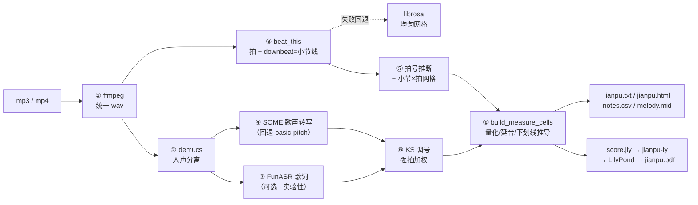
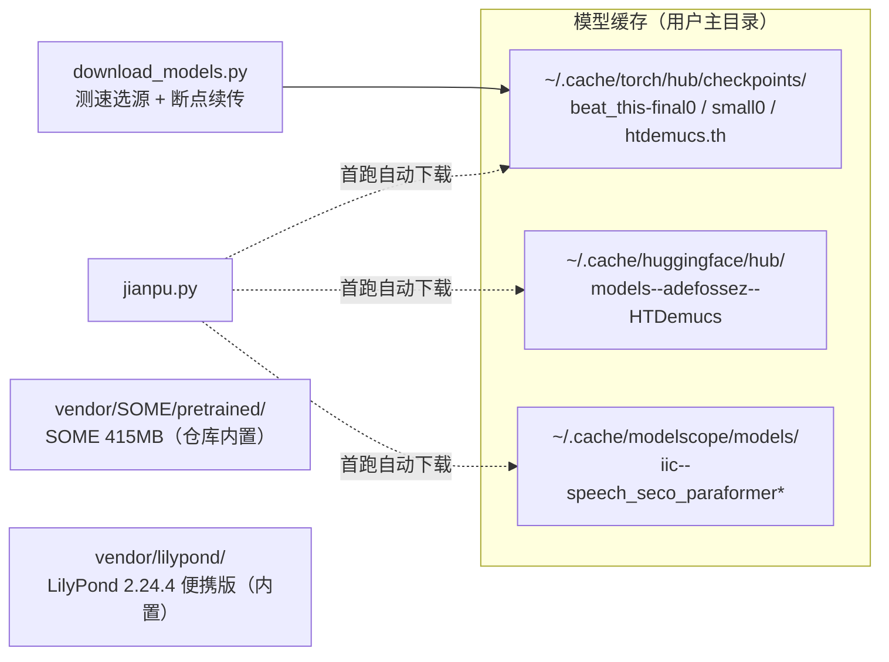

# AGENTS.md — jianpu-pipeline 工程/代理指南

面向 AI 代理（和新协作者）的项目操作指南。人读同样适用；更友好的入门见 `README.md`，
架构/数据流/算法细节的 mermaid 全图见 `ARCHITECTURE.md`。

## 文档地图

| 文档 | 内容 |
|---|---|
| `README.md` | 入门：安装、使用、参数、FAQ、已知局限 |
| `AGENTS.md`（本文） | 工程约定、常用命令、网络/代理、模型缓存、已知坑 |
| `ARCHITECTURE.md` | 架构总览、执行时序、引擎降级、量化/排版算法流程（mermaid） |

## 项目是什么

输入 mp3/mp4，输出**每小节人声简谱**：`jianpu.txt`（每行 4 小节）、`jianpu.html`（乐谱页）、
`jianpu.pdf`（LilyPond 出版级）、`notes.csv`、`melody.mid`、`lyrics.txt`。全程本地，无在线服务。

### 架构与流程（mermaid）



任一引擎缺失自动降级并在日志注明，流水线不中断。降级决策图与执行时序图见 `ARCHITECTURE.md` 第 3、4 节。

## 常用命令（Windows / Git Bash）

```bash
PY=.venv/Scripts/python.exe

$PY jianpu.py song.mp4 -o out            # 全自动（默认 best 引擎组合）
$PY jianpu.py vocal.wav --no-separate --bpm 90 --key C   # 清唱
$PY test/run_test.py                      # 端到端测试（必须 ALL PASS）
$PY download_models.py --check            # 模型资产自检
$PY download_models.py                    # 预下载缺失模型（自动测速选源）
$PY rerender_pdf.py                       # 只从 out/notes.csv 重排版 PDF（不重跑识别）
```

## 网络与模型下载（重要）

本机网络环境：直连 PyPI ~60KB/s、GitHub 443 常不通、JKU 云盘 ~10KB/s、
hf-mirror.com ~300KB/s、modelscope.cn 快。

### 代理启用（GitHub 不通 / 模型下载慢时）

PowerShell（参考命令，端口按本机代理实际配置）：

```powershell
$env:http_proxy="http://127.0.0.1:7897";$env:https_proxy="http://127.0.0.1:7897"
```

bash / Git Bash 等价：

```bash
export http_proxy=http://127.0.0.1:7897 https_proxy=http://127.0.0.1:7897
```

cmd 等价：

```cmd
set HTTP_PROXY=http://127.0.0.1:7897
set HTTPS_PROXY=http://127.0.0.1:7897
```

设置后重跑下载命令即可；`download_models.py --proxy http://127.0.0.1:7897` 可只对下载生效。
注意：代理对 google/github 有效，对 JKU 云盘无明显加速（瓶颈在对方路由），此时靠测速自动切 hf-mirror 镜像源。

### 免代理镜像

| 用途 | 镜像/做法 |
|---|---|
| pip | `-i https://pypi.tuna.tsinghua.edu.cn/simple` |
| GitHub 仓库/Release 下载 | URL 前缀加 `https://gh-proxy.com/`（ghproxy.net 不稳定） |
| HuggingFace | `HF_ENDPOINT=https://hf-mirror.com`（或直接用 hf-mirror.com 域名） |
| ModelScope(FunASR) | 国内直连即快，无需处理 |

### 模型资产与缓存位置



| 模型 | 位置 | 获取 |
|---|---|---|
| beat_this final0/small0 | `~/.cache/torch/hub/checkpoints/beat_this-*.ckpt` | `download_models.py`（多源测速）/首跑自动 |
| SOME ckpt | `vendor/SOME/pretrained/0119_continuous256_5spk/` | GitHub release v1.0.0-baseline（415MB，gh-proxy 下载） |
| demucs htdemucs | `~/.cache/torch/hub/checkpoints/htdemucs.th`（或 HF hub 缓存） | 首跑自动 |
| FunASR paraformer | `~/.cache/modelscope/models/iic--speech_seco_paraformer*` | 首跑自动（modelscope） |
| LilyPond 2.24.4 | `vendor/lilypond/`（便携版，已内置） | GitLab release zip 直解 |

## 已知坑（改代码前必读）

1. **venv 必须是 Python 3.10**（`.venv`，源自 `D:/Miniconda3/envs/musician/python.exe`）：
   Windows 下 basic-pitch 仅 py<3.11 走 onnxruntime；py≥3.11 会要求不存在的 TF 2.15 wheel
2. **中文 Windows GBK**：`subprocess(text=True)` 必须显式 `encoding='utf-8', errors='replace'`，
   否则中文歌名触发 UnicodeDecodeError；控制台日志避免非 GBK 字符（如 ✓），已加
   `sys.stdout/stderr.reconfigure(errors='replace')` 兜底
3. **jianpu-ly 语法约束**：q/s 时值前缀必须成组连杠（按拍整形：1音=四分/2音=两八分/
   3音=八分+两十六/4音=四十六），延音线 `-` 不能接在连杠拍之后，否则 barcheck fail
4. **SOME 推理不使用 f0**：v1.0.0-baseline 的 `me_infer.py` 中 f0 提取被注释、pitch 填零，
   RMVPE 模型下载无意义，勿再尝试
5. **SOME 后处理**：同音换字是无缝衔接（gap=0）的独立音符，只可合并"真重叠"碎片
   （`n.start < prev.end - 0.005`），不能按间隙合并
6. **纯人声输入** beat_this 有倍速歧义：管线护栏=downbeat 间距偏差>33% 自动切均匀网格；
   仍乱用 `--bpm` + `--beats-per-measure`
7. **量化规则**：音符归拍用"距整拍±0.15 吸附、其余 floor"（`locate_note`），八分/十六分归本拍
8. **许可**：SOME 模型权重 CC BY-NC-SA 4.0（非商用）；代码各组件 MIT/Apache
9. **测试锚点**：`test/run_test.py` 的回归断言锁定 `--transcriber basic-pitch --beat-engine librosa`
   确定性路径（合成正弦对 SOME/demucs 是分布外样本，不做内容断言）

## 目录结构

```
jianpu.py            # 主流水线（单文件，阶段①-⑧）
download_models.py   # 模型预下载/自检
rerender_pdf.py      # 从 notes.csv 重排版 PDF
requirements.txt     # pip 依赖（清华镜像安装）
vendor/SOME/         # SOME 源码+模型（openvpi）
vendor/lilypond/     # LilyPond 2.24.4 便携版
test/                # make_test_audio.py（合成已知答案音频）/ run_test.py
data/                # 测试音频与标准答案
out/                 # 真实歌曲输出（《寄往未来的信》）
```
