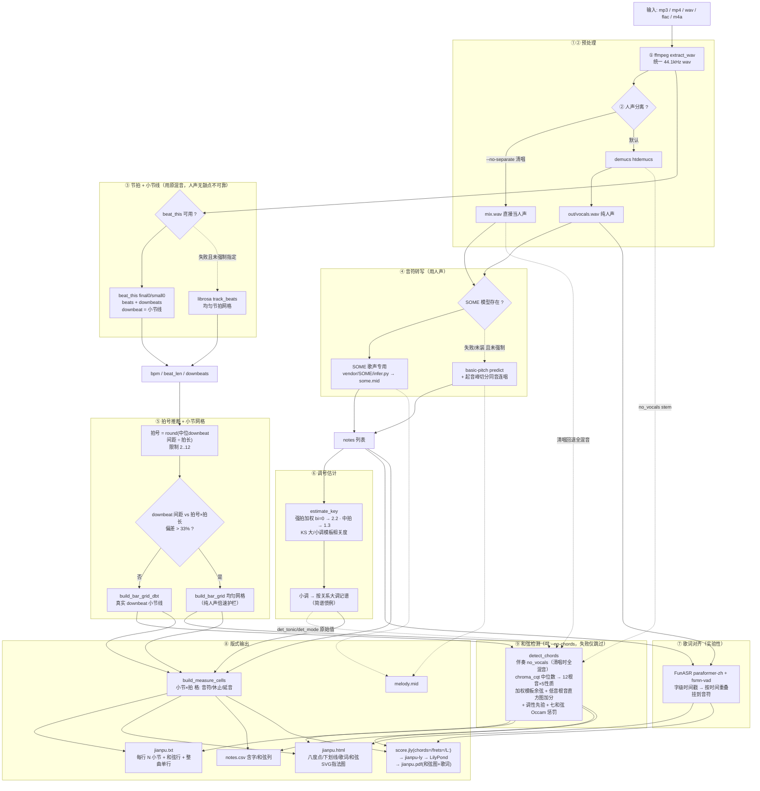
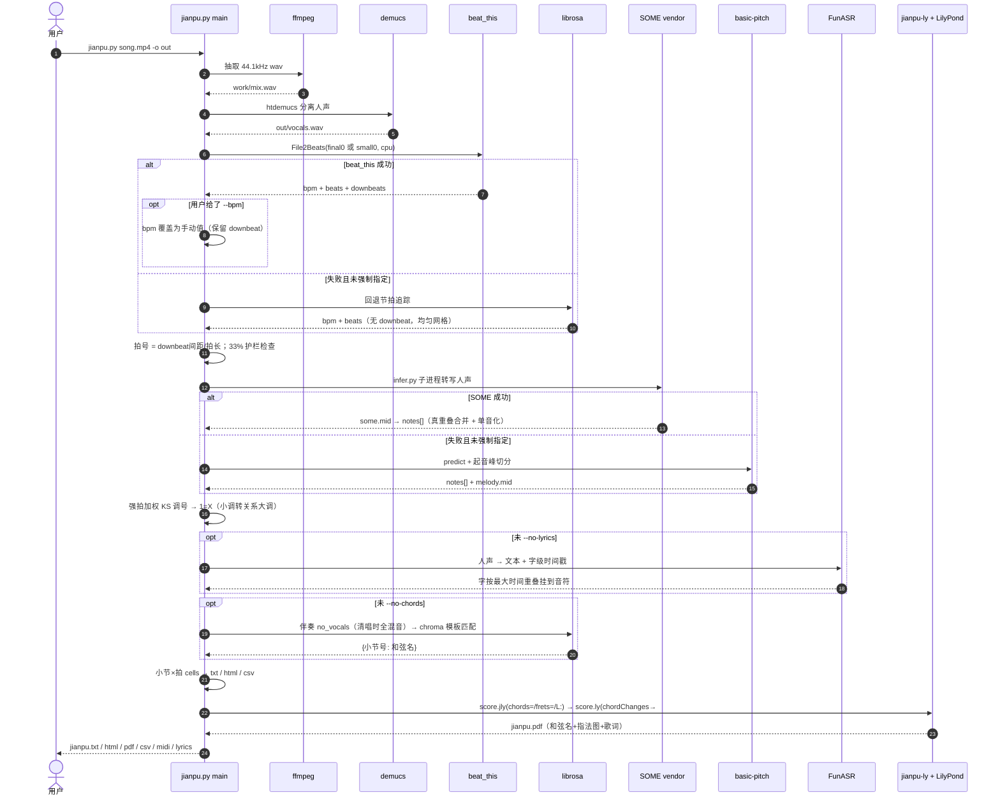
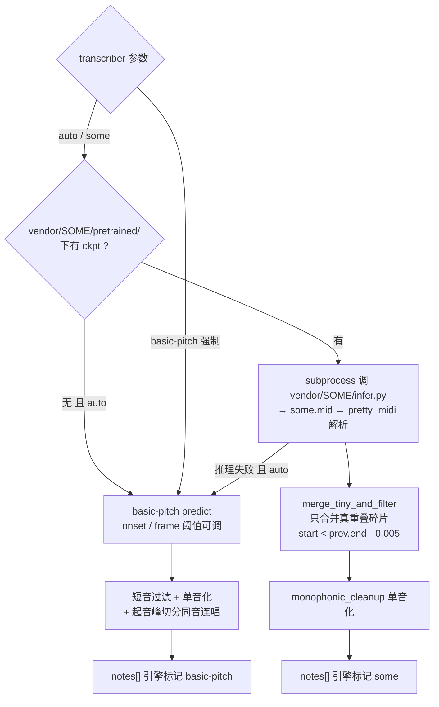
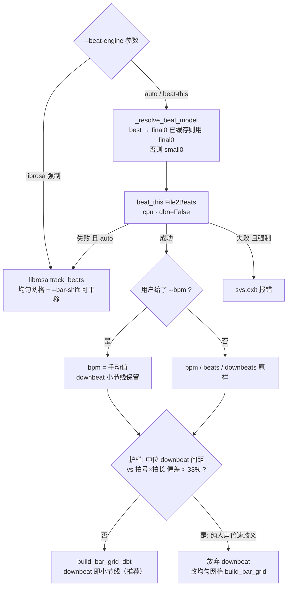
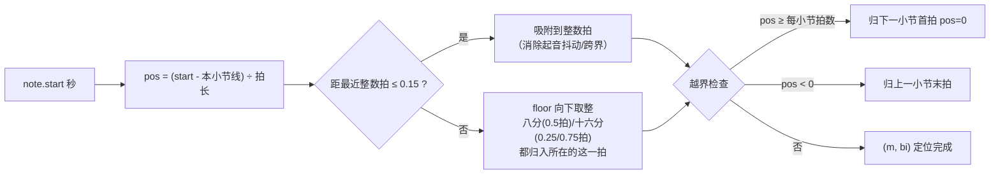
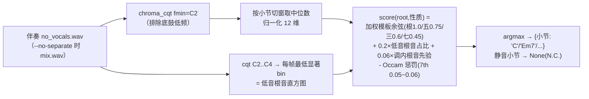
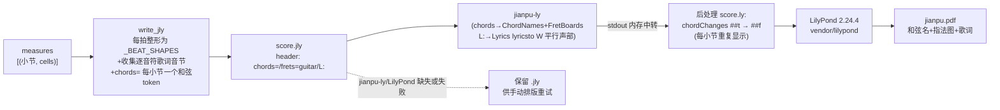
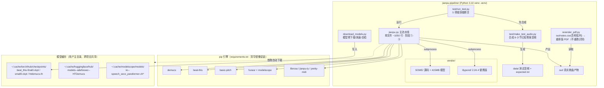

# ARCHITECTURE.md — jianpu-pipeline 架构与流程

本文用 **mermaid** 梳理系统的模块结构、端到端数据流、引擎降级策略与关键算法流程。
配套文档：`README.md`（入门/使用/FAQ）· `AGENTS.md`（工程约定、网络代理、已知坑）。

## 1. 系统定位

输入一首歌的音视频文件（mp3/mp4/wav/flac/m4a），**全本地、全开源**流水线输出
人声旋律的**每小节简谱**：文本（每行 4 小节+和弦行）、网页乐谱（八度点/下划线/歌词行/
和弦 SVG 指法图）、出版级**弹唱谱** PDF（jianpu-ly + LilyPond：每小节和弦名+吉他指法图、
简谱下逐音符歌词）、`notes.csv`、`melody.mid`。任一引擎缺失自动降级，流水线不中断。

## 2. 端到端架构总览

九个阶段（对应 `jianpu.py` `main()` 的执行顺序），实线为主数据流，虚线为失败回退：



## 3. 一次运行的执行时序



## 4. 引擎选择与降级策略

`auto` 模式 = 先试首选引擎，异常（未安装/无模型/推理失败）则回退并在日志注明；
**强制指定**（`--transcriber some` / `--beat-engine beat-this`）失败则直接 `sys.exit` 报错。

### 4.1 音符转写：SOME → basic-pitch



两条路径的关键差异：

| | SOME（首选） | basic-pitch（回退） |
|---|---|---|
| 定位 | 歌声专用（openvpi） | 通用乐器 |
| 同音换字 | 天然切成独立音符 | 常并成长音符 → 需起音峰切分救回 |
| 后处理 | 只可合并**真重叠**碎片（无缝 gap=0 的同音是独立音符，不能按间隙合并） | 切分三重护栏：音长≥0.95拍 · 切点强度≥0.75×自身起音 · 切距≥0.5拍且每音最多3刀 |
| f0 | 推理时填零，**RMVPE 不参与**（勿再下载） | — |
| 许可 | 模型权重 CC BY-NC-SA 4.0（非商用） | Apache 2.0 |

### 4.2 节拍引擎：beat_this → librosa



**为什么对纯人声要护栏**：beat_this 在无鼓点人声上常出现倍速/半速歧义（downbeat 间距与
拍号×拍长严重不符）。三道防线：`--bpm` 手动覆盖 → 拍号由 downbeat 间距自动推断 →
间距偏差>33% 自动切均匀网格。仍乱则 `--bpm` + `--beats-per-measure` 双指定。

### 4.3 模型选择（beat_this）

| 模型 | 大小 | 说明 |
|---|---|---|
| `final0` | 78MB | 论文平均 F1 更高；`--beat-model best`（默认）检测到已缓存即用它；CPU 耗时约 2 倍 |
| `small0` | 8MB | 回退档；实测常规流行曲两者输出常**完全一致**（《寄往未来的信》125.0BPM/106 小节线相同） |

预下载/测速选源见 `download_models.py`（JKU 官方云盘国内极慢，自动回退 hf-mirror 镜像）。

## 5. 小节网格与音符量化（`locate_note`）

音符起始时间 → (小节号 m, 拍序 bi) 的归位规则，是排版正确性的核心：



- ±0.15 吸附窗口：覆盖起音抖动与浮点漂移，又不至于把真正的后半拍吸走。
- 跨小节线音符：按量化后的 pos 归属头/尾小节，不会钳死在错误小节。

## 6. 拍格数据模型（`build_measure_cells`）

```text
notes[] ──locate_note──▶ placed{小节: {拍: [音符dict]}} ──延音填充──▶ measures = [(m, cells)]

拍格 cell 三态:
  None        休止       → 文本 '0' / jly '0'
  'hold'      延音       → 文本 '—' / jly '-'（仅可接在四分音符拍后）
  [dict...]   拍内1-4音   → 音符 dict = {pitch, dur(拍), oct 八度偏移, word 歌词字}
```

延音规则：该拍最长音符按 `round(时长拍数) - 1` 占据后续拍格，**不覆盖已有音符、不跨小节**；
首尾之间的空白小节（间奏）补齐，保持小节编号连续。

## 7. 排版输出层

### 7.1 输出矩阵

| 输出 | 生成函数 | 特点 |
|---|---|---|
| `jianpu.txt` | `render_score_rows` | 每行 N 小节（默认4），行首小节编号，` \| ` 分隔 + 整曲单行；有小节上方**和弦行**（按小节宽度对齐） |
| `jianpu.html` | `write_score_html` | 纯静态可打印：八度上下圆点、八分/十六分下划线、延音、歌词行；每小节上方**和弦名 + SVG 指法图**（开放把位字典 + E/A 型横按生成器，与 PDF 同源规则） |
| `notes.csv` | `main()` | 每音符：小节/拍/时间/音名/MIDI/简谱/**字**/力度/**和弦**（utf-8-sig 供 Excel） |
| `melody.mid` | SOME 或 basic-pitch 产物 | 旋律 MIDI |
| `score.jly` | `write_jly` | jianpu-ly 中间格式（可手工编辑再重排；含 `chords=`/`frets=`/`L:` 头部行） |

### 7.2 和弦检测（`detect_chords`，纯 librosa+numpy 零新模型）



- **为什么用伴奏轨**：人声旋律音（尤其 2nd/4th/6th 经过音）会把三和弦带偏成七和弦
  （混音下 F 和弦 + 强旋律 E 会被判成 Fmaj7，本质歧义）。
- **低音根音线索**：贝斯/钢琴左手/垫音最低音多为根音；基频低于 C2 时其二次谐波同音级落入窗内。
- **七和弦 Occam 惩罚**：泛音/邻小节谐波泄漏常凭空"点亮"七音，惩罚后只有七音真实存在才胜出
  （《寄往未来的信》调参对照：无惩罚 maj7 系占 65% → 0.05~0.06 惩罚后 G×23/D×18/C×18/Em7×12）。
- 词表：12 根音 × {maj, m, 7, m7, maj7}；每小节单一和弦，不含转位/sus/小节内变化。

### 7.3 PDF 排版链（jianpu-ly + LilyPond）



**barcheck 从构造上保证通过**：每拍按拍内音符数查表整形，时值恒等于 1.0 拍，
每小节恒等于拍号；延音线 `-` 只允许接在单 token（四分）拍之后：

| 拍内音符数 | jianpu-ly 前缀 | 时值 |
|---|---|---|
| 1 | 无前缀 | 四分音符 |
| 2 | `q q` | 两个八分（连杠） |
| 3 | `q s s` | 八分 + 两个十六分 |
| 4 | `s s s s` | 四个十六分 |

（jianpu-ly 的 q/s 记号必须**成组连杠**，孤立的 q/s 会编译失败——这是按拍整形的根本原因。）

## 8. 代码与资产地图



测试锚点：`run_test.py` 的回归断言锁定 `--transcriber basic-pitch --beat-engine librosa --no-chords`
确定性路径（合成正弦对 SOME/demucs 是分布外样本，只做结构性断言）；和弦检查在
`synth_accompaniment` 纯伴奏（C F C G ×2 已知循环）上断言 ≥7/8。

## 9. 关键设计决策速查

| # | 决策 | 原因 |
|---|---|---|
| 1 | 节拍用**原混音**、转写用**分离人声** | 鼓点在混音里，人声里没有；旋律在人声里，混音有和声干扰 |
| 2 | downbeat 即小节线（beat_this） | 真实小节线 vs librosa 均匀网格假设（无法处理变速/弱起） |
| 3 | SOME 只合并真重叠碎片 | 无缝衔接（gap=0）的同音换字是独立音符，按间隙合并会丢字 |
| 4 | 每拍按形状整形再喂 jianpu-ly | q/s 必须成组连杠，逐拍 1.0 时值让 barcheck 不可能失败 |
| 5 | ±0.15 吸附 else floor 量化 | 兼顾起音抖动与真实半拍位置（详见第 5 节） |
| 6 | KS 调号 + 强拍位置加权 | 纯音级直方图在音符增减时易翻转调号；重拍上的音级是更稳的调性线索 |
| 7 | 小调按关系大调记谱 | 简谱惯例（Am 歌记 1=C），减少变音记号 |
| 8 | 任一引擎缺失 → 优雅降级 + 日志注明 | 可用性优先：总能产出至少文本+HTML 简谱 |
| 9 | 全程 `subprocess` 显式 `encoding='utf-8'` | 中文 Windows GBK 控制台对 UTF-8 子进程输出会 UnicodeDecodeError |
| 10 | 和弦用**伴奏 stem** + 加权模板匹配（零新模型） | 人声旋律经过音会带偏和弦；chroma 模板分布内可测，无需引入重模型 |
| 11 | PDF 和弦/歌词走 jianpu-ly 原生 `chords=`/`frets=`/`L:` 平行声部 | 不碰简谱 Voice 的时值/barPos 账本，零 barcheck 风险；`chordChanges ##t→##f` 后处理实现"每小节都标" |
| 12 | HTML/PDF 指法图同源（开放字典 + E/A 型横按生成器） | 一份品位数据两处渲染，风格一致；PDF 侧 predefined 表已覆盖 12 根音×5 性质 |
